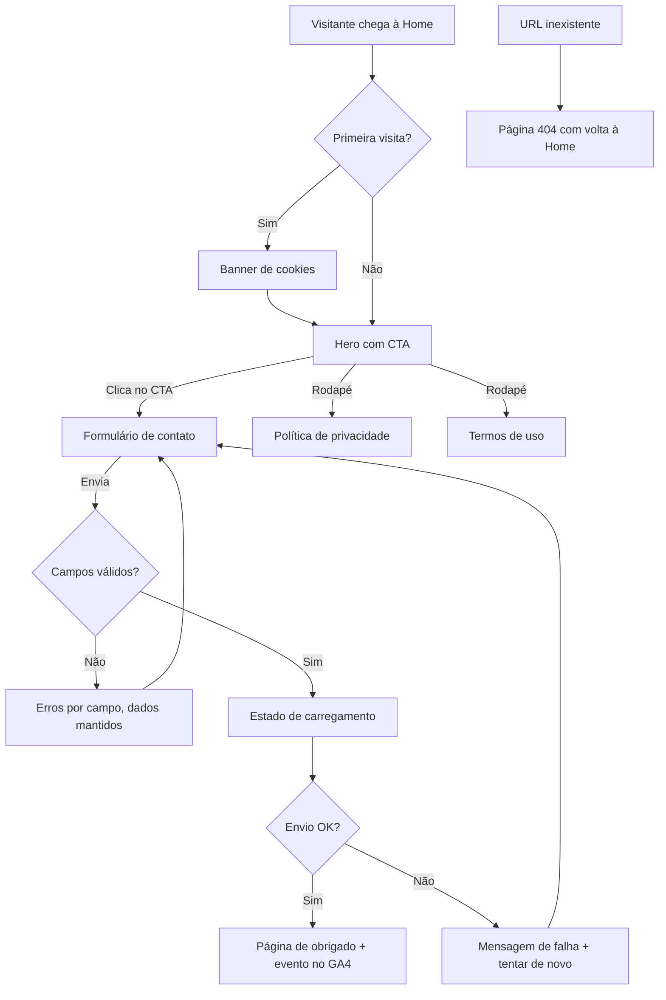

# App Flow — [Nome do cliente]

> Gerado a partir do BRIEF.md. Todo item do checklist de produção que tem página ou estado (404, carregando, erro, obrigado, cookies, páginas legais) precisa aparecer aqui.

## Páginas

| Rota | Página | Palavra-chave principal |
| --- | --- | --- |
| / | Home | [ ] |
| /obrigado | Obrigado | — |
| /privacidade | Política de privacidade | — |
| /termos | Termos de uso | — |
| (qualquer rota inexistente) | 404 | — |

## Fluxo (modelo: landing page de leads)

