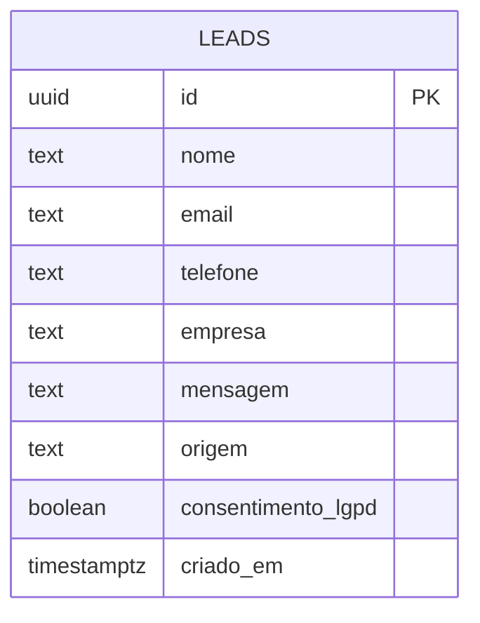

# SCHEMA.md — [Nome do cliente]

> Derivado do APP_FLOW.md: cada ponto em que o site recebe ou mostra dados vira uma entidade.
> Sites sem formulário nem login: registre só para onde vão os contatos (e-mail, CRM).

## Entidades

| Entidade | Campos | Regras de acesso | Integrações | Retenção (LGPD) |
| --- | --- | --- | --- | --- |
| leads | nome, email, telefone, empresa, mensagem, origem, consentimento_lgpd, criado_em | Visitante só insere, com consentimento; ninguém lê pelo site | E-mail de aviso, [CRM] | [12 meses sem contato] |

## Diagrama



## SQL (Supabase)

```sql
create table public.leads (
  id uuid primary key default gen_random_uuid(),
  nome text not null,
  email text not null,
  telefone text,
  empresa text,
  mensagem text,
  origem text,
  consentimento_lgpd boolean not null default false,
  criado_em timestamptz not null default now()
);

alter table public.leads enable row level security;

create policy "visitante envia lead com consentimento"
  on public.leads for insert to anon
  with check (consentimento_lgpd = true);

-- Sem política de leitura para visitantes:
-- os leads só são lidos pelo painel ou pelo servidor.
```

## Cuidados
- A chave service role nunca vai para o navegador.
- Este arquivo descreve a estrutura de dados do cliente: tratar como confidencial.
